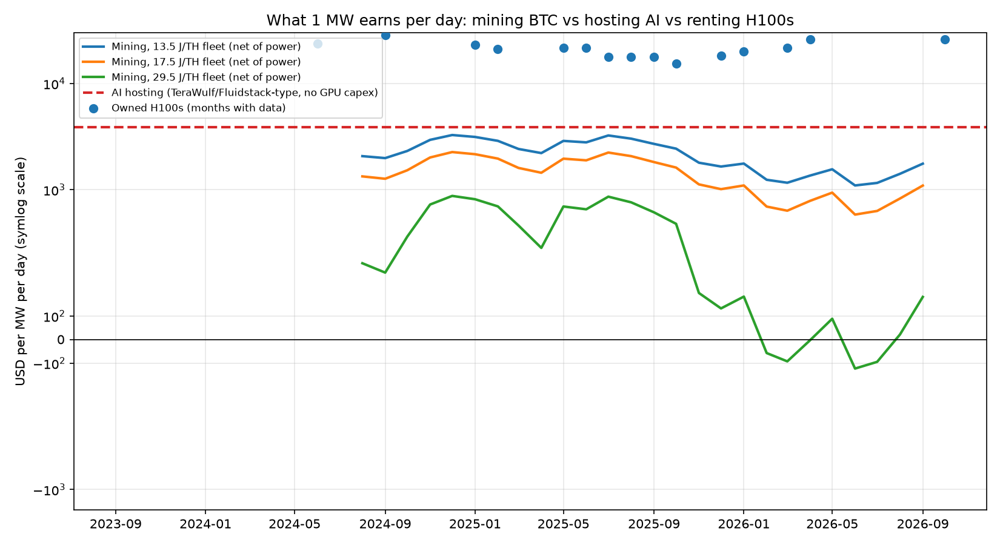

# MW index

Open notes on the economics of energy and compute: what 1 MW earns mining Bitcoin vs hosting AI, and what it takes to finance the switch. Built in public, one finding a week, with every number tied to a source you can check.

Who it's for: bitcoin miners of 5 to 50 MW wondering whether to move power to AI, the people who finance them, and anyone curious about where energy, Bitcoin and AI compute meet.



## Start here

| Folder | Question it answers |
| --- | --- |
| This page, [`mw_model.py`](mw_model.py) | What does 1 MW earn per day mining, hosting AI or renting out H100s, month by month? |
| [`costo-por-byte/`](costo-por-byte/) | How much energy goes into one vB of block space, and how much of it do fees pay? |
| [`costo-por-inscripcion/`](costo-por-inscripcion/) | Same, per inscription, rune and stamp, for 800 items |
| [`estudio-de-sitio/`](estudio-de-sitio/) | The one-sheet an operator gets: keep mining vs host AI vs own GPUs, with capex and payback |
| [`rentabilidad-diaria-ml/`](rentabilidad-diaria-ml/) | What 1 MW nets mining every day since 2016, and whether machine learning calls next month better than a simple rule |

## Build log: what we learned each week

Newest first. Each line links to the work or the source behind it.

### Week of 9 Nov 2026: machine learning does not beat today's power bill

- A daily dataset of what 1 MW nets mining since 2016 (3,921 days, three fleets): [`rentabilidad-diaria-ml/`](rentabilidad-diaria-ml/).
- Logistic regression, linear regression and SVR all lose to the rule "next month looks like this month". What an operator sees on today's bill is the better forecast.
- With power at 7 cents, a 29.5 J/TH fleet lost money in every 30-day window of 2026 (median −$14,493 per MW per month). It only breaks even under 5.17 cents/kWh.

### Week of 2 Nov 2026: the money follows the signed tenant

- Converting a mining site to host AI costs $8M to $11M per MW of critical IT ([TeraWulf](https://www.sec.gov/Archives/edgar/data/1083301/000110465925078084/tm2523008d2_ex99-1.htm) and [Cipher](https://www.sec.gov/Archives/edgar/data/1819989/000095010325012168/dp234624_ex9901.htm) filings). In Sep 2026 AI hosting paid 3.6 times what a 17.5 J/TH fleet made per MW and 21 times what a 29.5 J/TH fleet made, so the question is how to pay for the build.
- The site study: what a given MW earns in each of the three uses, with capex and payback: [`estudio-de-sitio/`](estudio-de-sitio/).
- Lenders follow the lease. [USD.AI](https://usd.ai/blog/usdai-underwriting-and-risk-management) lends up to 80% against GPUs in Tier III or IV sites and checks the offtake contract. On the sources we read, the equity for the other 20% shows up once a tenant has signed, and sometimes the tenant pays for the whole build ([Empery](https://www.sec.gov/Archives/edgar/data/0001829794/000168316826007266/empery_defa14a.htm)).
- That is why a leased MW and an unleased one are priced so differently: about $27M vs, in some cases, under $3M per MW ([CoinShares, Sep 2026](https://coinshares.com/insights/research-data/bitcoin-mining-report-q2-2026/)).

### Week of 26 Oct 2026: fees stopped paying for block space

- Runes at launch (block 840,000) paid 145% of the energy behind their bytes. By Sep 2026 a rune paid 0.2%: [`costo-por-inscripcion/`](costo-por-inscripcion/).
- Runes at launch were the exception. In early 2023 a median Bitcoin Frogs inscription covered 2% of its share of the block's energy, and NodeMonkes 6%.

### Week of 19 Oct 2026: one MW, three uses

- The model: hosting AI pays about $3,899 per MW per day. A 17.5 J/TH fleet made $583 in Jun 2026 and $1,095 in Sep, and a 29.5 J/TH fleet was at zero or below in 5 of the last 8 months.
- Energy per vB of block space vs the fee paid for it: users covered 76% of the energy in Apr 2024 (halving and Runes) and 1.2% in Sep 2026, with a 17.5 J/TH fleet: [`costo-por-byte/`](costo-por-byte/).

## Follow along

Watch or star the repo to get each week's update. Found a wrong number, or run a site and want to see your own MW in the model? Open an issue.

## Run it

```
pip install pandas matplotlib
python3 mw_model.py
```

Writes `out/mw_minar_vs_ia.png`, `out/fees_vs_tokens.png` and `out/tabla_mw.csv`.

## Files

- `mw_model.py`: the model. All assumptions live in the `SUPUESTOS` dict at the top (power price, fleet J/TH, PUE, H100s per MW, utilization, hosting rate, capex). Change them there, not in the formulas.
- `data/*.csv`: monthly series, one source URL per row. Gaps are real and not filled.
- `data/parametros.md`: per-MW parameters with their source.
- `out/tabla_mw.csv`: USD per MW per day by month for each use, and the gap vs a 17.5 J/TH fleet.
- `indice_mw_v0.ipynb`: same code, executed, with notes (in Spanish).

Column and variable names are in Spanish: `mes` month, `mina_vieja/media/nueva_neto` mining with a 29.5 / 17.5 / 13.5 J/TH fleet net of power, `hosting` AI hosting, `gpu_neto` owned H100s net of power, `brecha_*` gap multiple.

## Main assumptions

| Item | Value | Source |
| --- | --- | --- |
| Power price | US$0.048/kWh | Luxor, Jul 2026 |
| Fleets | 29.5 (S19j Pro), 17.5 (S21), 13.5 (S21 XP) J/TH | CoinShares, Luxor |
| AI hosting | US$1.85M per MW of IT per year | TeraWulf / Fluidstack |
| PUE | 1.3 | |
| H100s per MW of IT | 740 | derived from NVIDIA DGX H100 specs |
| GPU utilization | 71% | Epoch |
| Capex | ~US$0.85M per MW (mine), ~US$20M per MW (owned GPUs) | CoinShares Q4 2025 |

Mining revenue = hashprice (USD/PH/day) x PH/s that fit in 1 MW, minus 24 MWh of power. Hosting and GPU figures are per MW drawn from the grid (IT load = 1 / PUE).

## Limits

- Hashprice and BTC are monthly from Aug 2024 to Sep 2026. H100 prices are points from different segments (marketplace, 1-year contracts, mixed indices), not one consistent monthly series.
- Fees and token prices only overlap in one month, so there is no correlation to measure between them.
- Owned-GPU revenue ignores capex, financing, depreciation and staff. Hosting ignores data center capex.

## Changes since the first draft (19 Oct 2026)

- June 2026 hashprice and fee rows: source URL fixed to the June 2026 Luxor lookback (the old URL returned 404).
- May 2023 fee share: 50 instead of 100. The source says fees exceeded the block subsidy on 7 May 2023, which means more than 50% of miner revenue, not 100%.
- Chart labels translated to English. No number in `tabla_mw.csv` changed.

Corrections welcome: open an issue.
