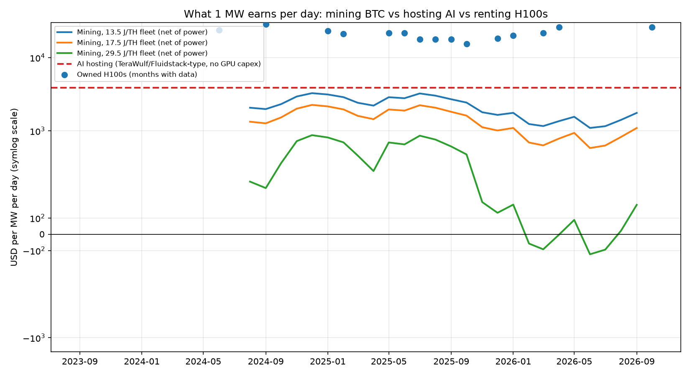

# MW index, v0

What 1 MW earns per day in three uses: mining Bitcoin, hosting AI for a third party, or renting out H100s you own. Plus a check on whether Bitcoin fees and inference token prices move together.



Second analysis, in [`costo-por-byte/`](costo-por-byte/): energy cost per vB of block space vs the fee users pay for it, monthly from Jan 2024 to Sep 2026.

## Run it

```
pip install pandas matplotlib
python3 mw_model.py
```

Writes `out/mw_minar_vs_ia.png`, `out/fees_vs_tokens.png` and `out/tabla_mw.csv`.

## Files

- `mw_model.py`: the model. All assumptions live in the `SUPUESTOS` dict at the top (power price, fleet J/TH, PUE, H100s per MW, utilization, hosting rate, capex). Change them there, not in the formulas.
- `data/*.csv`: monthly series, one source URL per row. Gaps are real and not filled.
- `data/parametros.md`: per-MW parameters with their source.
- `out/tabla_mw.csv`: USD per MW per day by month for each use, and the gap vs a 17.5 J/TH fleet.
- `indice_mw_v0.ipynb`: same code, executed, with notes (in Spanish).

Column and variable names are in Spanish: `mes` month, `mina_vieja/media/nueva_neto` mining with a 29.5 / 17.5 / 13.5 J/TH fleet net of power, `hosting` AI hosting, `gpu_neto` owned H100s net of power, `brecha_*` gap multiple.

## Main assumptions

| Item | Value | Source |
| --- | --- | --- |
| Power price | US$0.048/kWh | Luxor, Jul 2026 |
| Fleets | 29.5 (S19j Pro), 17.5 (S21), 13.5 (S21 XP) J/TH | CoinShares, Luxor |
| AI hosting | US$1.85M per MW of IT per year | TeraWulf / Fluidstack |
| PUE | 1.3 | |
| H100s per MW of IT | 740 | derived from NVIDIA DGX H100 specs |
| GPU utilization | 71% | Epoch |
| Capex | ~US$0.85M per MW (mine), ~US$20M per MW (owned GPUs) | CoinShares Q4 2025 |

Mining revenue = hashprice (USD/PH/day) x PH/s that fit in 1 MW, minus 24 MWh of power. Hosting and GPU figures are per MW drawn from the grid (IT load = 1 / PUE).

## Limits

- Hashprice and BTC are monthly from Aug 2024 to Sep 2026. H100 prices are points from different segments (marketplace, 1-year contracts, mixed indices), not one consistent monthly series.
- Fees and token prices only overlap in one month, so there is no correlation to measure between them.
- Owned-GPU revenue ignores capex, financing, depreciation and staff. Hosting ignores data center capex.

## Changes since the first draft (19 Oct 2026)

- June 2026 hashprice and fee rows: source URL fixed to the June 2026 Luxor lookback (the old URL returned 404).
- May 2023 fee share: 50 instead of 100. The source says fees exceeded the block subsidy on 7 May 2023, which means more than 50% of miner revenue, not 100%.
- Chart labels translated to English. No number in `tabla_mw.csv` changed.

Corrections welcome: open an issue.
