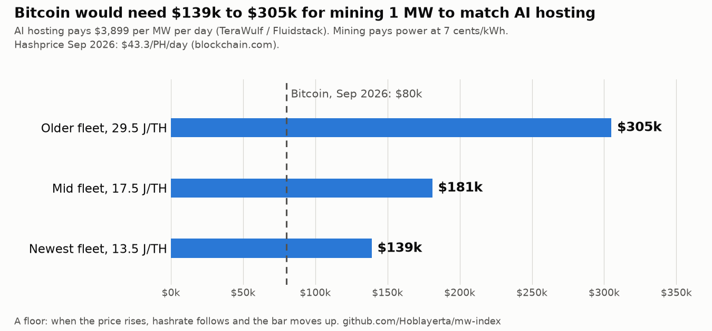

# MW index

Open research on the economics of energy and compute: what a megawatt earns mining Bitcoin vs hosting AI, what each path costs to build and run, and what it takes to finance the switch. Updated every week, every number linked to its source.

For bitcoin miners of 5 to 50 MW deciding whether to move power to AI, the people who finance them, and anyone who wants to follow where energy, Bitcoin and AI compute meet.

## This week's number: when would mining beat AI again?



| Fleet | Bitcoin needed to match AI hosting | If hosting paid half |
| --- | --- | --- |
| Older, 29.5 J/TH | $305k | $198k |
| Mid, 17.5 J/TH | $181k | $118k |
| Newest, 13.5 J/TH | $139k | $91k |

Bitcoin averaged $80k in Sep 2026. With power at 7 cents, mining 1 MW has to earn the hosting rate ($3,899 a day) plus its own power bill, which takes Bitcoin at 1.7 to 3.8 times its September price. It is a floor: when the price rises, hashrate follows. Script: [`rentabilidad-diaria-ml/empate_btc.py`](rentabilidad-diaria-ml/empate_btc.py).

## What one MW costs and earns, by path

Per MW of grid power, Sep 2026, power at $48/MWh ([Luxor](data/parametros.md)), PUE 1.3. From [`mw_model.py`](mw_model.py) and the [site study](estudio-de-sitio/).

| Path | Build cost per MW | Running cost per MW per day | Revenue per MW per day | Revenue per MWh used | Simple payback |
| --- | --- | --- | --- | --- | --- |
| Mine, older fleet (29.5 J/TH) | ~$0.85M for a new mine, machines aside ([CoinShares](data/parametros.md)) | $1,152 of power | $1,333 ($181 after power) | $56 | n/a: no public ASIC price per TH |
| Mine, mid fleet (17.5 J/TH) | same | $1,152 of power | $2,247 ($1,095 after power) | $94 | n/a |
| Mine, newest fleet (13.5 J/TH) | same | $1,152 of power | $2,913 ($1,761 after power) | $121 | n/a |
| Host AI for a tenant | $6.2M to $8.5M ($8M to $11M per MW of IT: [TeraWulf](https://www.sec.gov/Archives/edgar/data/1083301/000110465925078084/tm2523008d2_ex99-1.htm), [Cipher](https://www.sec.gov/Archives/edgar/data/1819989/000095010325012168/dp234624_ex9901.htm)) | Power paid by the tenant; site costs $585 to $1,170 (15% to 30% of rent) | $3,899 (TeraWulf / Fluidstack rate) | $162, plus the power the tenant pays | 5.1 to 8.5 years |
| Rent out your own H100s | ~$20M (CoinShares) | $1,152 of power, staff not modeled | $27,256 ($26,104 after power), Oct 2026 prices at 71% use | $1,136 | 2.1 years, before the GPUs lose value |

Site costs come from the NOI margins TeraWulf and Cipher report for their hosting leases (85%) and TeraWulf's Abernathy average over the lease (~70%). Paybacks have no financing; the next section adds it.

**In one line:** a MWh that costs $48 brings in $94 mining with a mid fleet and $162 hosting AI, but the hosting building costs 7 to 10 times a mine per MW.

## What it takes to finance the switch

From the [site study](estudio-de-sitio/) with a fictional 20 MW site (`out/fictional-site.pdf`), per MW moved to AI hosting.

- **Own cash before the first rent: $1.76M to $2.41M per MW.** That is 20% of the build, a 3-month debt reserve, interest during 12 months of construction and the mining income given up. Loan of 80% at 10% over 10 years, the structure [USD.AI](https://usd.ai/blog/usdai-underwriting-and-risk-management) publishes, at what it charged smaller operators ([American Compute, Oct 2026](https://www.amcompute.com/gpu-debt/pricing)).
- **Lenders want the rent to cover the payment 1.15 times.** On a 5-year loan it covers 0.52 to 0.87 times. On 10 years at 10% it passes only in the favorable case (1.29 times; 0.77 with a costly build and high site costs).
- **Any one of these makes it pass in the costly case:** a signed rent of $2.1M or more per MW per year (the benchmark gives $1.4M), a build at $7.4M or less per MW of IT (filings show $8M to $11M), or the owner putting in 46% instead of 20%. Power price and fleet do not move the debt. Rent and build cost do.
- **About 12 months from signing to first rent**, then the tenant ramps up over months ([Cipher](https://www.sec.gov/Archives/edgar/data/1819989/000181998926000007/cipherdigital_businessup.htm), [TeraWulf](https://www.sec.gov/Archives/edgar/data/0001083301/000108330126000162/a_wulfearningsreleaseq22026.htm)).

Who pays for the build changes everything:

| Structure (one public deal each) | Owner's cash per MW | Owner nets per MW per month |
| --- | --- | --- |
| Owner builds with an 80% loan | $1.76M to $2.41M | $21,211 to −$25,872 |
| Tenant pays the build, triple net lease ([Empery](https://www.sec.gov/Archives/edgar/data/0001829794/000168316826007266/empery_defa14a.htm)) | none | $14,826 |
| Joint venture with the tenant, owner 50.1% ([TeraWulf Abernathy](https://www.sec.gov/Archives/edgar/data/1083301/000110465925102858/tm2529509d1_8k.htm)) | $0.10M to $0.87M | $30,215 |
| Preferred equity after a signed lease ([Macquarie in Applied Digital](https://www.sec.gov/Archives/edgar/data/1144879/000149315225002040/form8-k.htm)) | $0.03M to $0.68M | $2,822 to −$44,261 |

All four come from large sites with a signed or near-signed tenant. We have not found one offered to a 5 to 50 MW site.

## What an AI tenant asks of a mining site

- **Power that stays on**, usually paid by the tenant ("Power 100% passed-through to tenant", [TeraWulf](https://www.sec.gov/Archives/edgar/data/0001083301/000110465925102858/tm2529509d1_ex99-3.htm)).
- **120 to 132 kW per rack with liquid cooling to the chip**, for one NVIDIA GB200 NVL72 rack ([Supermicro](https://www.supermicro.com/en/products/rack/srs-gb200-nvl72)). Air-cooled mining containers are not built for that.
- **A Tier III or IV building** if the GPUs are financed ([USD.AI](https://usd.ai/blog/usdai-underwriting-and-risk-management)), plus a colocation agreement, a lien waiver from the site owner and the lender's right to step in.

## Start here

| Folder | Question it answers |
| --- | --- |
| [`mw_model.py`](mw_model.py), this page | What does 1 MW earn per day mining, hosting AI or renting out H100s, month by month? |
| [`estudio-de-sitio/`](estudio-de-sitio/) | The study an operator gets for their own site: three paths, capex, financing, who pays the build, how many MW to move |
| [`rentabilidad-diaria-ml/`](rentabilidad-diaria-ml/) | What 1 MW nets mining every day since 2016, and whether machine learning calls next month better than a simple rule |
| [`costo-por-byte/`](costo-por-byte/) | How much energy goes into one vB of block space, and how much of it fees pay |
| [`costo-por-inscripcion/`](costo-por-inscripcion/) | Same, per inscription, rune and stamp, for 800 items |

## Build log: what we learned each week

Newest first.

### Week of 9 Nov 2026: machine learning does not beat today's power bill

- A daily dataset of what 1 MW nets mining since 2016 (3,921 days, three fleets): [`rentabilidad-diaria-ml/`](rentabilidad-diaria-ml/).
- Logistic regression, linear regression and SVR all lose to the rule "next month looks like this month". What an operator sees on today's bill is the better forecast.
- With power at 7 cents, a 29.5 J/TH fleet lost money in every 30-day window of 2026 (median −$14,493 per MW per month). It only breaks even under 5.17 cents/kWh. For mining to pay as much as hosting AI, Bitcoin would need $139k to $305k.

### Week of 2 Nov 2026: the money follows the signed tenant

- Converting a mining site to host AI costs $8M to $11M per MW of critical IT. In Sep 2026 AI hosting paid 3.6 times what a 17.5 J/TH fleet made per MW and 21 times what a 29.5 J/TH fleet made, so the real question is how to pay for the build.
- The site study now models the financing: own cash per MW, debt coverage, 12 months of construction, the tenant's ramp and four ways to pay for the build: [`estudio-de-sitio/`](estudio-de-sitio/).
- On the sources we read, equity for the owner's 20% shows up once a tenant has signed, and sometimes the tenant pays for the whole build. That is why a leased MW and an unleased one are priced so differently: about $27M vs, in some cases, under $3M per MW ([CoinShares, Sep 2026](https://coinshares.com/insights/research-data/bitcoin-mining-report-q2-2026/)).

### Week of 26 Oct 2026: fees stopped paying for block space

- Runes at launch (block 840,000) paid 145% of the energy behind their bytes. By Sep 2026 a rune paid 0.2%: [`costo-por-inscripcion/`](costo-por-inscripcion/).
- Runes at launch were the exception. In early 2023 a median Bitcoin Frogs inscription covered 2% of its share of the block's energy, and NodeMonkes 6%.

### Week of 19 Oct 2026: one MW, three uses

- The model: hosting AI pays about $3,899 per MW per day. A 17.5 J/TH fleet made $583 in Jun 2026 and $1,095 in Sep, and a 29.5 J/TH fleet was at zero or below in 5 of the last 8 months.
- Energy per vB of block space vs the fee paid for it: users covered 76% of the energy in Apr 2024 (halving and Runes) and 1.2% in Sep 2026, with a 17.5 J/TH fleet: [`costo-por-byte/`](costo-por-byte/).

## Who is behind this

José Román Andrade, founder of Offtake, which works on how 5 to 50 MW bitcoin miners finance moving power to AI. Román studied Renewable Energy Engineering, specializing in power electronics, at the Universidad Michoacana de San Nicolás de Hidalgo in Morelia, Mexico. The daily dataset and the machine learning analysis in [`rentabilidad-diaria-ml/`](rentabilidad-diaria-ml/) were his final project for the university's machine learning seminar (Nov 2026). Before Offtake he was a tech lead at an edtech startup and built a wallet on the Stellar mainnet with friends.

- X: [@0xscarf](https://x.com/0xscarf)
- LinkedIn: [joseromanandrade](https://www.linkedin.com/in/joseromanandrade/)
- 20 minutes to talk about your site: [calendly.com/hoblayerta](https://calendly.com/hoblayerta)

Run a site and want to see your own MW in the model? Book a call or open an issue. Watch or star the repo to get each week's update.

## How the model works

```
pip install pandas matplotlib
python3 mw_model.py
```

Writes `out/mw_minar_vs_ia.png`, `out/fees_vs_tokens.png` and `out/tabla_mw.csv`.


### Files

- `mw_model.py`: the model. All assumptions live in the `SUPUESTOS` dict at the top (power price, fleet J/TH, PUE, H100s per MW, utilization, hosting rate, capex). Change them there, not in the formulas.
- `data/*.csv`: monthly series, one source URL per row. Gaps are real and not filled.
- `data/parametros.md`: per-MW parameters with their source.
- `out/tabla_mw.csv`: USD per MW per day by month for each use, and the gap vs a 17.5 J/TH fleet.
- `indice_mw_v0.ipynb`: same code, executed, with notes (in Spanish).

Column and variable names are in Spanish: `mes` month, `mina_vieja/media/nueva_neto` mining with a 29.5 / 17.5 / 13.5 J/TH fleet net of power, `hosting` AI hosting, `gpu_neto` owned H100s net of power, `brecha_*` gap multiple.

### Main assumptions

| Item | Value | Source |
| --- | --- | --- |
| Power price | US$0.048/kWh | Luxor, Jul 2026 |
| Fleets | 29.5 (S19j Pro), 17.5 (S21), 13.5 (S21 XP) J/TH | CoinShares, Luxor |
| AI hosting | US$1.85M per MW of IT per year | TeraWulf / Fluidstack |
| PUE | 1.3 | |
| H100s per MW of IT | 740 | derived from NVIDIA DGX H100 specs |
| GPU utilization | 71% | Epoch |
| Capex | ~US$0.85M per MW (mine), ~US$20M per MW (owned GPUs) | CoinShares Q4 2025 |

Mining revenue = hashprice (USD/PH/day) x PH/s that fit in 1 MW, minus 24 MWh of power. Hosting and GPU figures are per MW drawn from the grid (IT load = 1 / PUE).

### Limits

- Hashprice and BTC are monthly from Aug 2024 to Sep 2026. H100 prices are points from different segments (marketplace, 1-year contracts, mixed indices), not one consistent monthly series.
- Fees and token prices only overlap in one month, so there is no correlation to measure between them.
- Owned-GPU revenue ignores financing, depreciation and staff. The site study adds capex, financing and site costs for the hosting path.

### Changes since the first draft (19 Oct 2026)

- June 2026 hashprice and fee rows: source URL fixed to the June 2026 Luxor lookback (the old URL returned 404).
- May 2023 fee share: 50 instead of 100. The source says fees exceeded the block subsidy on 7 May 2023, which means more than 50% of miner revenue, not 100%.
- Chart labels translated to English. No number in `tabla_mw.csv` changed.

Corrections welcome: open an issue.
