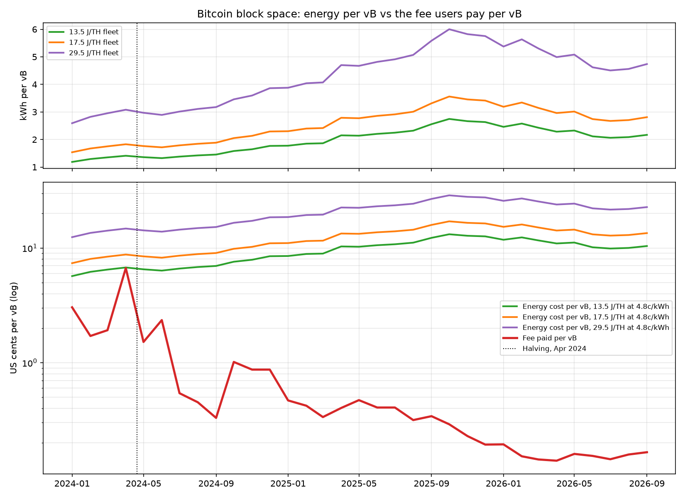

# Energy cost per vB of Bitcoin block space, v0

Monthly from Jan 2024 to Sep 2026: how much energy it takes to produce one vB of block space (kWh and USD) vs the fee users pay for that vB.



## Run it

```
pip install pandas matplotlib
python3 costo_por_byte.py           # uses the raw data in data/
python3 costo_por_byte.py --bajar   # downloads it again
```

## Two months, three fleets

| Month | Fleet | kWh per vB | Energy cost per vB at 4.8c/kWh | Fee paid per vB | Fee as % of energy |
| --- | --- | --- | --- | --- | --- |
| Apr 2024 | 13.5 J/TH | 1.41 | 6.8c | 6.68c | 99% |
| Apr 2024 | 17.5 J/TH | 1.83 | 8.8c | 6.68c | 76% |
| Apr 2024 | 29.5 J/TH | 3.08 | 14.8c | 6.68c | 45% |
| Sep 2026 | 13.5 J/TH | 2.17 | 10.4c | 0.17c | 1.6% |
| Sep 2026 | 17.5 J/TH | 2.81 | 13.5c | 0.17c | 1.2% |
| Sep 2026 | 29.5 J/TH | 4.74 | 22.7c | 0.17c | 0.7% |

Apr 2024: 624 EH/s, 101 sat/vB average (Runes launch and halving). Sep 2026: 944 EH/s, 2.1 sat/vB.

## Method

Per block (600 s average):

- Energy per block (kWh) = network hashrate (TH/s) x fleet efficiency (J/TH) x 600 / 3,600,000
- kWh per vB = energy per block / vB per block (block weight / 4)
- Energy cost per vB = kWh per vB x US$0.048/kWh
- Fee per vB = average fees per block (BTC) x BTC price / vB per block

Fleet efficiency is shown as three lines (13.5, 17.5 and 29.5 J/TH), the same fleets as the MW index. The real network average moved down over the period, so the true line drifts from the upper band toward the middle one.

## Data

All from the public mempool.space API, saved raw in `data/`:

| Series | Endpoint |
| --- | --- |
| Daily average hashrate | `/api/v1/mining/hashrate/3y` |
| Average block size and weight | `/api/v1/mining/blocks/sizes-weights/3y` |
| Average fees per block and BTC price (`USD` field) | `/api/v1/mining/blocks/fees/3y` |

Output: `out/tabla_costo_por_vb.csv` (column names in Spanish: `kwh_por_vb_*` kWh per vB, `costo_usd_por_vb_*` energy cost in USD per vB, `fees_usd_por_vb` fee paid in USD per vB, `usuario_paga_pct_energia` fee as % of the 17.5 J/TH energy cost).

## Limits

- Hashrate is mempool.space's estimate from block times, not a measured figure.
- Power price is a single assumption (US$0.048/kWh, Luxor Jul 2026); real costs vary by site.
- Data pulled 21 Oct 2026; the series stops at Sep 2026, the last full month.
